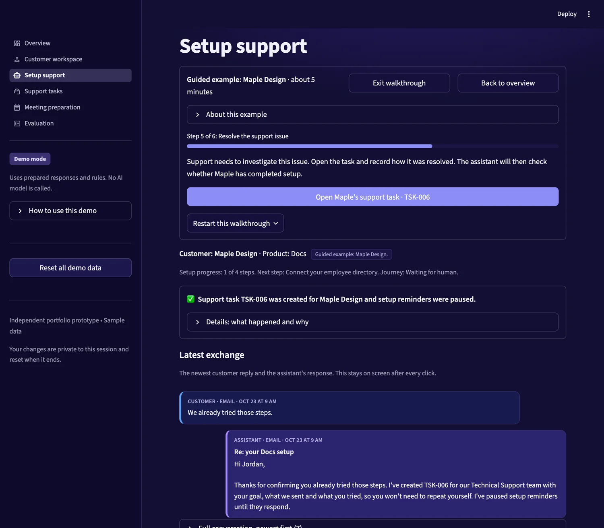
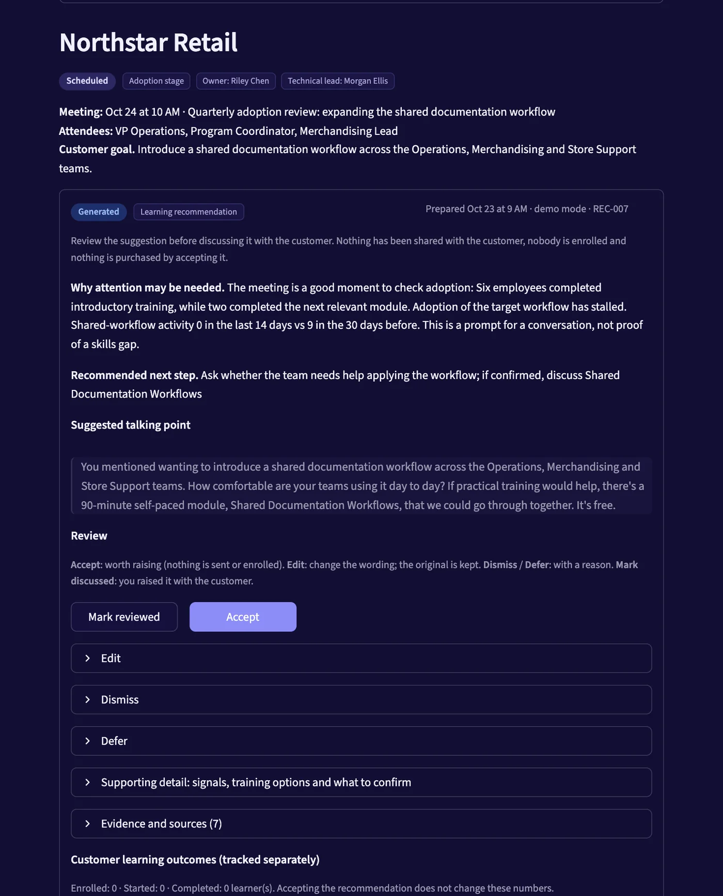

# Customer Success Orchestrator

Customer Success Orchestrator is an interactive prototype that uses customer context to guide setup support, coordinate human handoffs, and prepare customer meeting recommendations.

**[Live demo](https://customer-success-orchestrator.streamlit.app/)** · **[Case study](https://ajantika.github.io/customer-success-orchestrator.html)** · [Portfolio](https://ajantika.github.io/)

> **Demo scope.** The demo uses sample customer data and prepared responses. The default experience does not call an AI model, send real messages, or connect to live customer systems. It demonstrates agent-style workflows (tools, rules, review steps and activity history); it is not a deployed autonomous AI system, and nothing here is evidence of production results.

<p>
  
  
</p>

## The problem and who it is for

Customer information is often spread across product reports, support systems and learning records. Teams need to see which customers are stuck, why, and what action would help. Finding that context and coordinating follow-up can involve repetitive manual work. This prototype explores that problem. It is not based on customer interviews or production data.

| User | What they need |
|---|---|
| Customer success | See stalled setup and decide who needs help |
| Support | Receive enough context to investigate without repeating earlier troubleshooting |
| Sales and customer success | Prepare relevant questions and recommendations before a customer meeting |
| Product and operations | Inspect workflow behaviour, review decisions and feedback |

## Two walkthroughs

**1. Help a customer complete setup (example: Maple Design)**

1. Review the customer's goal and setup progress, and find the next incomplete step.
2. Send relevant guidance from the product documentation, respecting the planned rollout date, message limits and opt-outs.
3. When the customer reports a problem without detail, ask which error they see; then send only the matching section and cite it.
4. If the customer says they already tried the steps, create one support task with the goal and prior troubleshooting, and pause reminders.
5. When support records how it was fixed, re-check setup progress. Resolving a task does not complete onboarding.
6. Close the journey only when the required sample product events show completion. A completion claim typed without events keeps the journey open.

**2. Prepare for a customer conversation (example: Northstar Retail)**

1. Gather the customer's goal, setup progress, workflow activity, learning records, open issues and rollout plan.
2. Prepare a summary, a suggested next step, a customer-facing talking point and a learning suggestion with prerequisites.
3. Show the evidence and the open questions. Low usage is a reason to ask, not proof of a skills gap.
4. A reviewer can accept, edit, dismiss or defer the suggestion, with reasons. The original wording is kept beside any edit.
5. Record whether it was discussed. Customer enrolment and learning progress are tracked separately; accepting a suggestion never enrols anyone.

Start either one from the Overview page of the demo. Written scripts: [Maple Design](docs/DEMO_SCRIPT_MAPLE.md) · [Northstar Retail](docs/DEMO_SCRIPT_NORTHSTAR.md).

## Key product decisions

| Decision | Why it matters |
|---|---|
| Keep the selected customer across pages | Prevents acting on the wrong company's information |
| Respect planned rollout dates | Avoids contacting customers before they intend to start |
| Pause reminders while support investigates | Avoids conflicting or repetitive outreach |
| Include previous troubleshooting in handoffs | Gives support the context to continue |
| Show the evidence behind recommendations | Lets a reviewer judge whether a suggestion is appropriate |
| Keep review decisions separate from customer outcomes | Prevents acceptance being mistaken for adoption |
| Check completion evidence | Avoids closing a journey on a message alone |

More decisions, alternatives and trade-offs: [docs/DECISIONS.md](docs/DECISIONS.md).

## Architecture and data flow

```
Streamlit pages ──button callbacks only──► services.py (setup support) / team.py (meeting preparation)
                                                │
                                   agent.py: bounded loop, step limit
                                   a rule-based decider proposes the next tool call
                                                │
                              tools.py: validate input → allow-list → account boundary →
                              idempotency → run → record evidence and audit entry
                                                │
        ┌──────────────┬──────────────────┬─────┴────────┬─────────────────────┐
        ▼              ▼                  ▼              ▼                     ▼
    rules.py     retrieval.py      training catalog   SQLite (in memory,   evaluation.py
 (eligibility,   (keyword TF-IDF   (token overlap     one per session):    (35 workflow
  transitions)    over Markdown)    over 8 courses)   accounts, journeys,   checks, ratings)
                                                      meetings, learners,
                                                      recommendations,
                                                      feedback, runs, tool executions
```

- **Data.** 43 sample accounts are generated from a fixed seed (`cso/datagen.py`, `cso/seed_team.py`). Each visitor session gets its own in-memory SQLite database that resets when the session ends.
- **Rules in code.** Eligibility for outreach, allowed state transitions, frequency limits, opt-outs, completion evidence and recommendation validity are Python functions (`cso/rules.py`, `cso/tools.py`), not prompt text.
- **Tools.** 16 tools with Pydantic input and output models and no free-form SQL or code execution. A run is bound to one account, has a per-workflow allow-list, and mutating tools use idempotency keys. Review actions can only be recorded by a human reviewer.
- **Retrieval.** Section-level TF-IDF keyword matching over 13 sample Markdown documents (`kb/`), with a "not supported" fallback. There are no embeddings, no vector search and no language-model generation in the default experience. The training catalog is searched by token overlap.
- **Evidence.** Read tools return evidence items with a source and timestamp. A recommendation may cite only evidence gathered in the same run, and a message may cite only documents it retrieved.
- **Activity history.** Agent runs, tool executions, guard events (blocked sends, duplicates prevented) and review history are stored and shown in the interface.
- **Simulated.** Email, chat, calendar, support queue and learning records are sample data inside the app. There are no external integrations.
- **Optional model adapter.** `cso/llm.py` contains an adapter for the Anthropic API that reuses the same tools and rules. It is hidden unless `CSO_ADVANCED=1`, is tested only with a fake client, and has not been run against a real model here.

More detail: [docs/ARCHITECTURE.md](docs/ARCHITECTURE.md).

## Evaluation and verified checks

Verified on **23 October 2026** (version `87d57d8` of `main`, re-run after the wording changes in this update; Python 3.13.5, Streamlit 1.57.0):

- `pytest`: **77 tests pass**: 41 workflow and unit tests, 19 UI click-through tests, 13 customer-context regression tests, 4 tests of the optional model adapter with a fake client.
- `python -m cso.evaluation`: **35 of 35 workflow checks pass**. They cover outreach before rollout, opt-outs, frequency limits, duplicate messages, tasks and recommendations, completion and reminders, failed handoffs reported honestly, account isolation, unsupported claims, prerequisites and paid options, dismissed and deferred suggestions, and review decisions staying separate from learning outcomes.
- Browser walkthroughs of both workflows were run locally against that version.

What is **not** evaluated: language quality (the app can record human ratings, none are recorded here), the optional model adapter against a real model, and any business outcome. Details and per-check evidence: [docs/EVALUATION.md](docs/EVALUATION.md) · usability notes: [docs/USABILITY_REVIEW.md](docs/USABILITY_REVIEW.md).

## Run it locally

Developed and tested with Python 3.13.

```bash
git clone https://github.com/ajantika/customer-success-orchestrator.git
cd customer-success-orchestrator
python3 -m venv .venv && source .venv/bin/activate
pip install -r requirements.txt
streamlit run app.py        # entry point: app.py
pytest                      # tests
python -m cso.evaluation    # workflow checks
```

No account, API key or configuration is needed. Optional environment variables: `CSO_ADVANCED=1` shows reviewer-only options (situation scenarios, demo clock, a switch that simulates a failed handoff, the configuration page, and the optional model adapter); `ANTHROPIC_API_KEY` and `CSO_MODEL` apply only to that adapter. Never commit a key; `.streamlit/secrets.toml` is git-ignored.

## Current limitations

- Email, chat, calendar, support and learning data are simulated; nothing is sent, scheduled, enrolled or purchased.
- Reply understanding is a keyword screen, so paraphrases may be treated as unknown. Retrieval has no synonym handling.
- Thresholds (stalled days, message limits, stale data) are demo values, not benchmarks. All metrics shown come from sample data and imply nothing about real improvement.
- Scope is setup support and meeting preparation only. There is no billing, renewal or expansion logic.
- Laptop and desktop screens only; narrow screens were not a goal.
- Built with AI-assisted development. I set the scope, rules and review criteria and checked the behaviour; the code was written largely with an AI coding assistant.

## How I would measure it in a pilot (proposed, not achieved)

| Goal | Proposed measure |
|---|---|
| Help customers get started | Setup completion rate and time to first value |
| Reduce repetitive work | Manual follow-ups and meeting preparation time |
| Improve support handoffs | Time to resolution and repeated requests for context |
| Make recommendations useful | Review, acceptance, edit, dismissal and discussion rates |
| Support learning | Enrolment, course starts and completion |
| Understand downstream value | Meaningful product usage after assistance or training |
| Avoid unnecessary contact | Duplicate outreach, opt-outs and inappropriate reminders |

Establish a baseline first and, where feasible, compare a pilot group with a comparable group. A before-and-after change alone would not show cause.

## Repository guide

```
app.py            Streamlit entry point
cso/              rules, tools, agent loop, data generation, retrieval, evaluation, UI pages
kb/               sample product documentation and learning paths (Markdown)
tests/            pytest suite
docs/             product brief, architecture, decisions, operating model, evaluation, usability review, demo scripts
```

Deploy to Streamlit Community Cloud with `app.py` as the main file; leave secrets empty for a public demo.
